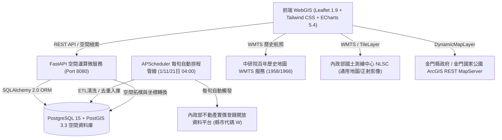

# 金門地政雲 (Kinmen Land Cloud) - 系統架構與部署維運手冊

> **對標系統**：臺北地政雲 (`fun=g11` 整合資訊查詢系統)  
> **核心特色**：內政部實價登錄動態更新 × 金門都市計畫自然村 × 國家公園雙軌管制 × 戰地政務歷史航照捲簾 × 農地農舍合規檢測器

---

## 系統架構總覽 (Architecture Overview)



---

## 一鍵容器化部署 (Docker Compose Deployment)

### 1. 前置需求
- 已安裝 **Docker** (20.10+) 與 **Docker Compose** (v2+)
- 伺服器開放對外連接埠：`8080` (WebGIS 服務)

### 2. 啟動指令
在專案根目錄執行以下指令：
```bash
# 1. 構建並啟動 PostgreSQL 15 + PostGIS 與 FastAPI 容器
docker compose up -d --build

# 2. 檢查容器運作狀態
docker compose ps

# 3. 查閱即時日誌
docker compose logs -f web
```

### 3. 系統端點驗證
- **WebGIS 首頁**：`http://localhost:8080/`
- **FastAPI 互動式 API 文件 (Swagger UI)**：`http://localhost:8080/docs`
- **系統健康檢查**：`http://localhost:8080/api/v1/health`
- **歷史同步日誌**：`http://localhost:8080/api/v1/pipeline/sync-logs`

---

## 本地開發與免 Docker 執行模式 (Local Development)

若本機尚未安裝 Docker，系統支援純 Python + SQLite 空間相容模式：

```bash
# 1. 安裝必要套件
pip install -r requirements.txt

# 2. 初始化資料庫並載入全縣 250 地段與 859+ 實價登錄資料
python -m backend.init_db

# 3. 啟動後端伺服器 (包含每旬自動排程管線)
python run_backend.py
```

開啟瀏覽器前往 `http://localhost:8080/` 即可立即操作。

---

## 內政部每旬實價同步排程 (Decennial Sync Pipeline)

- **自動排程時間**：每月 **1 日、11 日、21 日 凌晨 04:00** 自動啟動。
- **資料來源**：內政部不動產交易開放資料庫金門縣專區（代碼 `W`，買賣 `W_lvr_land_A.csv` 與預售屋 `W_lvr_land_B.csv`）。
- **手動立即同步**：
  - 前端介面：前往【實價篩選】分頁，點擊【立即同步】按鈕。
  - 命令列觸發：
    ```bash
    curl -X POST http://localhost:8080/api/v1/pipeline/trigger-sync
    ```

---

## 核心 API 路由清單 (API Reference)

| 方法 | 端點 | 說明 |
| :--- | :--- | :--- |
| `GET` | `/api/v1/health` | 系統健康狀態、資料庫筆數與排程狀態 |
| `GET` | `/api/v1/sections` | 取得金門全縣 250 地段名稱與代碼清單 |
| `GET` | `/api/v1/real-estate/filter` | 多維度實價登錄篩選（行政區/建物型態/價格/關鍵字） |
| `GET` | `/api/v1/real-estate/nearby` | 給定坐標半徑環域搜尋最近成交案件 |
| `GET` | `/api/v1/real-estate/trends` | 產出各行政區歷季均價走勢與型態佔比數據 (ECharts) |
| `POST` | `/api/v1/gis/identify` | 空間相交識別（都市計畫分區、國家公園分區、建蔽容積） |
| `POST` | `/api/v1/gis/calculate-capacity` | 自然村與商業區/住宅區法定建管規模試算 |
| `POST` | `/api/v1/gis/evaluate-farmland` | 金門農地分割與農舍興建資格合規檢測器 (農發條例§16/§18) |
| `POST` | `/api/v1/pipeline/trigger-sync` | 手動立即觸發內政部每旬實價登錄增量爬蟲同步 |
| `GET` | `/api/v1/pipeline/sync-logs` | 查詢歷次自動同步日誌與新增/更新統計 |
